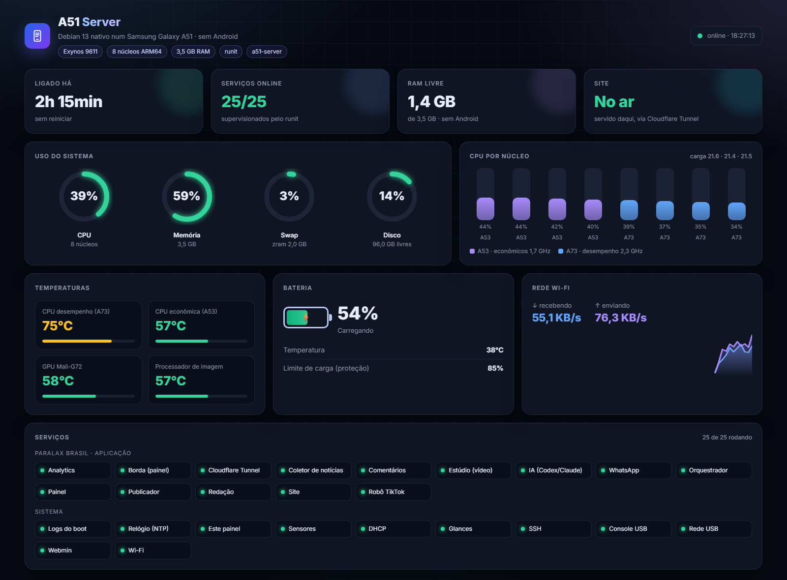

# A51 Server OS: native Debian on a Samsung Galaxy A51

Turn a **Samsung Galaxy A51 (SM-A515F)** into a headless **Debian 13 ARM64 server** that boots **directly into Debian, with no
Android running**, on Samsung's own kernel. Once the guide is done the phone gives you:

- runit as PID 1, with supervised services (sshd, Wi-Fi, DHCP, NTP), all restarted automatically if they crash
- **~3.2 GB of RAM free** for your apps (Android left ~1.3 GB)
- Wi-Fi without Android (the Samsung `scsc_wlbt` driver with the firmware copied from your own phone)
- an emergency **root console over USB serial**, plus an optional USB network
- the display powered off, the **battery charge capped at 85%**, and automatic recovery from Wi-Fi drops


<sub>The author's phone, live: 25/25 services up (including a real website and its 14 services), temperatures, battery and per-core CPU. See [docs/DASHBOARD.md](docs/DASHBOARD.md).</sub>

> 🇧🇷 Versão em português: [README.pt-BR.md](README.pt-BR.md)

> **Tested on exactly one configuration:** SM-A515F, bootloader **U8** (`A515FXXU8HWK1`, Android 13 / One UI 5.1).
> Other bootloader revisions or A51 variants (A515U/W/FN, A51 5G) may behave differently. Read [docs/LESSONS-LEARNED.md](docs/LESSONS-LEARNED.md) first.

## ⚠️ Read this first

| Risk | Consequence |
|---|---|
| Unlocking the bootloader | **Wipes all data** |
| Booting any modified image | **Trips the Knox e-fuse forever** (Samsung Pay, Secure Folder and some banking apps stop working, even after going back to stock) |
| Writing to the wrong partition (`efs`, `sec_efs`, `param`, the boot LUNs `sdb`/`sdc`, `uh`...) | IMEI loss or a **hard brick** |
| Running a phone 24/7 on a charger | Battery swelling: keep the 85% cap and good ventilation |

Everything here is done **at your own risk**. No firmware or proprietary blob is distributed: you extract them from your own device.

## How it works

```
S-Boot (Samsung) ──> boot.img  =  Samsung kernel 4.14 (unchanged) + Samsung DTB (unchanged) + OUR initramfs
                                   │
                                   └─ /init (busybox): mount userdata ─> switch_root ─> /data/debian-server/rootfs
                                                                                           └─ runit (PID 1) ─> services
```

- **Only the ramdisk is replaced.** The kernel, the DTB and the Samsung signature block/AVB footer are kept byte-for-byte.
- The bootloader requires the **stock Samsung-signed `vbmeta`**, but it accepts a modified `boot.img` (orange state). That fact is what makes all of this possible.
- Debian lives in `/data/debian-server/rootfs`, a folder on the userdata f2fs partition **outside Android's file-based encryption**, so the native boot can read it.
- The Android system partitions stay installed but **dormant**, and you can go back at any time (see [Going back to Android](#going-back-to-android)).

## Requirements

- Galaxy A51 SM-A515F (see the note above), USB cable, PC (Windows or Linux)
- `adb`, **Odin** (Windows) or Heimdall, Python 3 with `pip install lz4`
- The **stock firmware for your exact version** (e.g. with [Bifrost](https://github.com/zacharee/Bifrost) or samloader)
- [Magisk](https://github.com/topjohnwu/Magisk) (used once to get root and set everything up from Android)
- About 2 hours, and a phone you can afford to wipe

## Step by step

### 1. Unlock the bootloader
Settings → Developer options → **OEM unlocking** ON. Power off, hold **Vol+ and Vol−** and plug the USB cable in. On the warning
screen, **long-press Vol+** and confirm. The phone wipes and reboots. Do the setup **with internet access**, then check that
"OEM unlocking" is **grayed out**. In Download Mode, `KG STATE` must not be `Prenormal`.

### 2. Root with Magisk: the A51 U8 way
1. Copy the stock `AP_*.tar.md5` to the phone and patch it in the Magisk app ("Select and Patch a File").
2. `adb pull` the resulting `magisk_patched-*.tar`.
3. **Don't flash that tar as-is**, because its modified vbmeta causes `AVB Fail / vbmeta: no sign info`. Build a tar that has only the patched boot and the stock vbmeta:
   ```sh
   python tools/mk-odin-boot-tar.py --boot magisk_patched-XXXX.tar --ap AP_A515F....tar.md5 --out magisk-boot.tar
   ```
4. In Odin, put `magisk-boot.tar` in the **AP** slot and leave the other slots empty. When the phone drops into Recovery, run **Wipe data/factory reset**, then Reboot.
5. Set the phone up, install the Magisk app, accept "additional setup", and grant root to *Shell* in the Superuser tab.

### 3. Back up the critical partitions (don't skip this)
```sh
for p in efs sec_efs cpefs boot recovery vbmeta vbmeta_samsung dtbo param up_param persistent steady keystorage; do
  adb exec-out su -c "dd if=/dev/block/by-name/$p" > $p.img       # read-only
done
```
Keep **`efs`/`sec_efs`** (IMEI and radio calibration) somewhere safe. They cannot be recovered from anywhere else.

### 4. Install Debian (chroot, from Android)
```sh
# Debian 13 arm64 rootfs (e.g. the official debian:trixie-slim layer) -> /data/debian-server/rootfs
adb push rootfs.tar.gz /data/local/tmp/
adb shell su -c 'mkdir -p /data/debian-server/rootfs && tar -xzpf /data/local/tmp/rootfs.tar.gz -C /data/debian-server/rootfs'
adb push scripts/android/start.sh scripts/android/shell.sh /data/debian-server/
adb push scripts/android/setup-inside.sh your_key.pub /data/debian-server/rootfs/tmp/   # rename the key to authorized_keys
adb shell su -mm -c '/data/debian-server/shell.sh bash /tmp/setup-inside.sh'
```
`setup-inside.sh` fixes Android's *paranoid network* (groups 3003/3004), installs sshd and creates the user `server`
(SSH key only). Add the packages needed for the native boot:
`apt install busybox-static runit chrony wpasupplicant dhcpcd-base cpio kmod openssh-sftp-server`.

### 5. Prepare the native boot
```sh
adb push scripts/android/prepare-native.sh /data/local/tmp/
adb shell su -c 'sh /data/local/tmp/prepare-native.sh'   # copies Wi-Fi firmware, imports the saved Wi-Fi network, creates /efs
```
Copy `rootfs-overlay/` into the rootfs (runit stages, services, `a51-reboot`), create `/etc/service-native/` with symlinks to
`/etc/sv/{wpa,dhcp,ssh,chrony,usbcon,usbdhcp,bootlog}`, then build the initramfs **inside Debian**:
```sh
sh scripts/debian/build-initramfs.sh initramfs/init     # -> /tmp/initramfs-a51-{test,prod}.cpio.gz
```

### 6. Build the boot images
```sh
python tools/bootimg.py unpack boot.img boot-unpacked            # your Magisk boot backup (the one that works)
python tools/bootimg.py unpack recovery.img recovery-unpacked    # your stock recovery backup
SAMSUNG_TAIL_FROM=recovery.img python tools/bootimg.py pack recovery-unpacked initramfs-a51-test.cpio.gz recovery-native-test.img
SAMSUNG_TAIL_FROM=boot.img     python tools/bootimg.py pack boot-unpacked     initramfs-a51-prod.cpio.gz boot-native-prod.img
```
`bootimg.py` round-trips the stock images **byte-identically**. Check that on your own files before you trust it.

### 7. Test safely from the recovery partition
The **test** initramfs has a **dead-man timer**: if Debian doesn't report healthy (SSH up and a reachable network) within 5 minutes,
it reboots, and the normal boot brings Android back. It also clears the `boot-recovery` message that Android writes to `misc`.
```sh
adb push recovery-native-test.img /data/local/tmp/
adb shell su -c 'sh tools/flash-recovery-from-android.sh /data/local/tmp/recovery-native-test.img <sha256>'
adb reboot recovery
```
Find the phone on your network (`ssh server@<ip>`) or on the USB serial COM port.

### 8. Make it permanent
From the running native Debian:
```sh
sudo sh tools/flash-partition.sh boot /tmp/boot-native-prod.img <sha256>
sudo a51-reboot
```
From now on every boot goes to Debian. The recovery partition keeps the test image as a maintenance fallback.

## Daily use

```sh
sudo sv status /etc/service-native/*          # services
sudo a51-reboot [poweroff|recovery|download]  # there is no systemd
cat /var/log/a51/boot.log                     # boot log (initramfs + runit); kernel logs in /var/log/a51/dmesg-*.txt
```
**Add your own service:** create `/etc/sv/myapp/run` (`#!/bin/sh`, `exec 2>&1`, `exec chpst -u server /path/to/app`),
`chmod +x` it and `ln -s /etc/sv/myapp /etc/service-native/`. Non-root processes need **groups 3003/3004** to open sockets
(the Android kernel has `CONFIG_ANDROID_PARANOID_NETWORK`).

## Monitoring dashboard
A modern read-only dashboard (`http://<phone-ip>/`): usage gauges, per-core CPU, real temperatures (CPU clusters, GPU),
battery with the 85% cap, Wi-Fi traffic and every service's state. About 55 MB of RAM and ~1% CPU.
Setup: [docs/DASHBOARD.md](docs/DASHBOARD.md).

## Limitations (stock kernel)

| Missing | Why | Workaround |
|---|---|---|
| PostgreSQL | no `CONFIG_SYSVIPC` (`shmget: Function not implemented`) | SQLite, or rebuild the kernel |
| Docker / Podman | no user/IPC namespaces, veth, bridge | run apps as runit services (mount namespaces still work) |
| systemd | no `CONFIG_FHANDLE` | runit (included) |
| Bluetooth, camera, audio, modem | Android-only proprietary stacks | none |

The TrustZone threads stay in `D` state forever (they wait for Android's `tzdaemon`), which raises the load average (~16) without using CPU.

## Going back to Android
`sudo a51-reboot download`, then in Odin flash a tar with your **backed-up Magisk `boot.img` + stock vbmeta** (built with
`mk-odin-boot-tar.py`). For a full stock restore, flash BL+AP+CP+CSC of the original firmware.

## Repository layout
| Path | What |
|---|---|
| `initramfs/init` | the busybox `/init`: USB console, userdata mount, `switch_root`, dead-man timer (test mode) |
| `rootfs-overlay/` | runit stages 1/2/3, services, `a51-reboot` |
| `tools/bootimg.py` | unpack/pack Android boot image v2 (incl. recovery DTBO and the Samsung signature/AVB footer) |
| `tools/mk-odin-boot-tar.py` | Odin AP tar = boot.img + **stock** vbmeta |
| `tools/flash-*.sh` | partition writers with size/hash checks and read-back verification (boot/recovery only) |
| `scripts/android/` | chroot phase (start/shell/setup, Magisk `service.d`), firmware/Wi-Fi import |
| `docs/` | [lessons learned](docs/LESSONS-LEARNED.md), [hardware & kernel audit](docs/HARDWARE-AUDIT.md), [self-hosted n8n guide](docs/N8N.md) |

Script comments are in Portuguese (the project started in Brazil). PRs that translate them are welcome.

## Credits
- Magisk issue [#2272](https://github.com/topjohnwu/Magisk/issues/2272): "vbmeta error no sign info (A51)", the "patch boot only" hint
- postmarketOS [samsung-a51](https://wiki.postmarketos.org/wiki/Samsung_Galaxy_A51_(samsung-a51)) port: Wi-Fi firmware list, USB networking notes
- Debian, BusyBox, runit, Magisk, Bifrost

License: MIT (scripts and docs only, see [LICENSE](LICENSE)).

---

<p align="center"><i>We stood on the shoulders of giants to see endless possibilities.</i><br>
<i>Subimos aos ombros de gigantes para ver infinitas possibilidades.</i></p>
